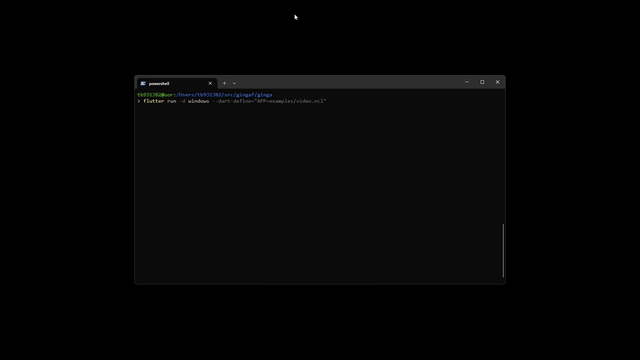
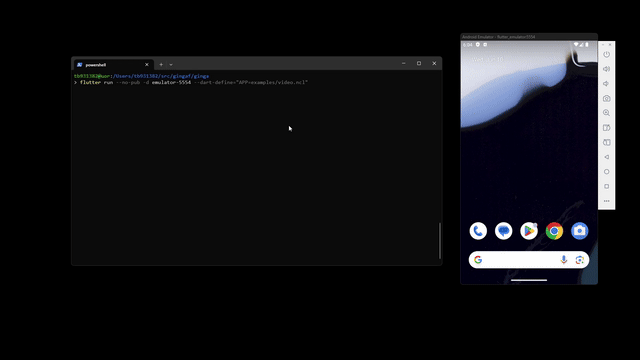
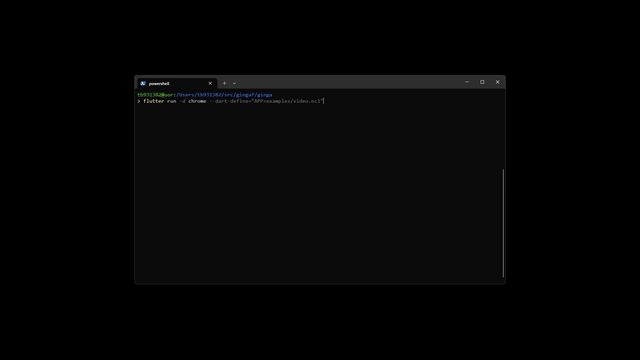
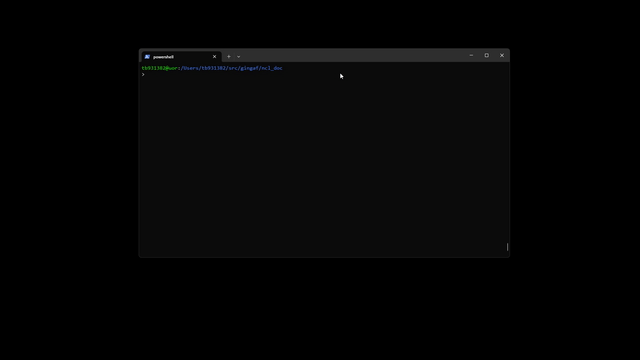

<header class="academic-header">
<h1 class="academic-title">gingaf: Headless and Multiplatform Execution of ITU-SBTVD NCL Applications</h1>
<div class="academic-authors">
<div class="academic-author">
<div class="author-name"><a href="https://alanlivio.github.io">Alan Guedes</a></div>
<div class="author-inst">University of Reading</div>
</div>
</div>
<div class="academic-conference">ACM MM 2025</div>
<div class="academic-links">
<a class="academic-link-btn" href="assets/pdfs/main.pdf">
<svg class="link-icon" xmlns="http://www.w3.org/2000/svg" viewBox="0 0 24 24" width="20" height="20" fill="currentColor"><path d="M12 16L16 11H13V3H11V11H8L12 16ZM19 18H5V11H3V19C3 19.5523 3.44772 20 4 20H20C20.5523 20 21 19.5523 21 19V11H19V18Z"/></svg>
<span>Paper</span>
</a>
<a class="academic-link-btn" href="slides/">
<svg class="link-icon" xmlns="http://www.w3.org/2000/svg" viewBox="0 0 24 24" width="20" height="20" fill="currentColor"><path d="M13 21V23H11V21H3C2.44772 21 2 20.5523 2 20V4C2 3.44772 2.44772 3 3 3H21C21.5523 3 22 3.44772 22 4V20C22 20.5523 21.5523 21 21 21H13ZM4 5V19H20V5H4ZM10 7.5L16 12L10 16.5V7.5Z"/></svg>
<span>Slides</span>
</a>
<a class="academic-link-btn" href="https://github.com/ginga-org-br/gingaf/releases/tag/v0.1.0">
<svg class="link-icon" xmlns="http://www.w3.org/2000/svg" viewBox="0 0 24 24" width="20" height="20" fill="currentColor"><path d="M12 .297c-6.63 0-12 5.373-12 12 0 5.303 3.438 9.8 8.205 11.385.6.113.82-.258.82-.577 0-.285-.01-1.04-.015-2.04-3.338.724-4.042-1.61-4.042-1.61C4.422 18.07 3.633 17.7 3.633 17.7c-1.087-.744.084-.729.084-.729 1.205.084 1.838 1.236 1.838 1.236 1.07 1.835 2.809 1.305 3.495.998.108-.776.417-1.305.76-1.605-2.665-.3-5.466-1.332-5.466-5.93 0-1.31.465-2.38 1.235-3.22-.135-.303-.54-1.523.105-3.176 0 0 1.005-.322 3.3 1.23.96-.267 1.98-.399 3-.405 1.02.006 2.04.138 3 .405 2.28-1.552 3.285-1.23 3.285-1.23.645 1.653.24 2.873.12 3.176.765.84 1.23 1.91 1.23 3.22 0 4.61-2.805 5.625-5.475 5.92.42.36.81 1.096.81 2.22 0 1.606-.015 2.896-.015 3.286 0 .315.21.69.825.57C20.565 22.092 24 17.592 24 12.297c0-6.627-5.373-12-12-12"/></svg>
<span>Software Code</span>
</a>
<a class="academic-link-btn" href="https://github.com/alanlivio/paper-gingaf-acm-mm26">
<svg class="link-icon" xmlns="http://www.w3.org/2000/svg" viewBox="0 0 24 24" width="20" height="20" fill="currentColor"><path d="M12 .297c-6.63 0-12 5.373-12 12 0 5.303 3.438 9.8 8.205 11.385.6.113.82-.258.82-.577 0-.285-.01-1.04-.015-2.04-3.338.724-4.042-1.61-4.042-1.61C4.422 18.07 3.633 17.7 3.633 17.7c-1.087-.744.084-.729.084-.729 1.205.084 1.838 1.236 1.838 1.236 1.07 1.835 2.809 1.305 3.495.998.108-.776.417-1.305.76-1.605-2.665-.3-5.466-1.332-5.466-5.93 0-1.31.465-2.38 1.235-3.22-.135-.303-.54-1.523.105-3.176 0 0 1.005-.322 3.3 1.23.96-.267 1.98-.399 3-.405 1.02.006 2.04.138 3 .405 2.28-1.552 3.285-1.23 3.285-1.23.645 1.653.24 2.873.12 3.176.765.84 1.23 1.91 1.23 3.22 0 4.61-2.805 5.625-5.475 5.92.42.36.81 1.096.81 2.22 0 1.606-.015 2.896-.015 3.286 0 .315.21.69.825.57C20.565 22.092 24 17.592 24 12.297c0-6.627-5.373-12-12-12"/></svg>
<span>LaTeX/Website Code</span>
</a>
</div>
</header>

<div class="abstract-container" markdown="1">
<div class="abstract-inner" markdown="1">

## Abstract

The Nested Context Language (NCL) is a core component of the ITU-T and SBTVD television standards. It is legally mandated and installed on 100% of certified Digital TV sets and set-top boxes across Brazil and several Latin American countries. This massive deployment impacts over 60 million people. However, the ecosystem of NCL development tools is limited. In this context, we present <span style="font-variant: small-caps;">gingaf</span>, an open-source implementation of an NCL player built in Flutter. It supports a headless execution engine that schedules NCL events in-memory without requiring any UI and provides a foundation for NCL developer tooling. We also proposed a UI component that achieves multiplatform visual rendering of NCL documents on Windows, mobile, and Web from a single codebase.

</div>
</div>

## Architecture

<span style="font-variant: small-caps;">gingaf</span> is built around two main components (Figure below): the NCL Logic as a self-contained execution engine that manages the NCL event state machine with no knowledge of any display context; and NCL UI as a Flutter widget that drives the engine and maps its output to native platform widgets.


## Example: Multiplatform Execution

The following NCL code (`video.ncl`) demonstrates a simple video presentation with two synchronized background images that appear sequentially. This illustrates the capabilities of NCL for multiplatform environments.

```xml
<ncl>
  <body>
    <port id="init" component="video"/>
    <media id="video" src="https://flutter.github.io/assets-for-api-docs/assets/videos/butterfly.mp4">
      <area id="a1" begin="2s" end="4s"/>
    </media>
    <media id="green_bg">
      <property name="background" value="green"/>
      <property name="bounds" value="0%,80%,20%,20%"/>
    </media>
    <media id="red_bg">
      <property name="background" value="red"/>
      <property name="bounds" value="80%,80%,20%,20%"/>
      <property name="explicitDur" value="2s"/>
    </media>
    <link id="l1">
      <bind role="onBegin" component="video" interface="a1"/>
      <bind role="start" component="green_bg"/>
    </link>
    <link id="l2">
      <bind role="onEnd" component="video" interface="a1"/>
      <bind role="stop" component="green_bg"/>
      <bind role="start" component="red_bg"/>
    </link>
  </body>
</ncl>
```

## Multi-platform Demos

<table>
  <tbody>
    <tr>
      <td align="center" width="50%">
        <br />
        Windows
      </td>
      <td align="center" width="50%">
        <br />
        Android
      </td>
    </tr>
    <tr>
      <td align="center" width="50%">
        <br />
        Chrome
      </td>
      <td align="center" width="50%">
        <br />
        CLI (headless execution)
      </td>
    </tr>
  </tbody>
</table>

## Execution Instructions

To run the <span style="font-variant: small-caps;">gingaf</span> (either the presentation layer with GUI or the headless execution engine for testing), execute the following commands:

```bash
git clone -b v0.1.0 https://github.com/ginga-org-br/gingaf
cd gingaf/ncldoc
make deps
dart lib/main.dart ../ginga/examples/video.ncl
cd ../ginga
make deps # See SETUP.md for environment configuration
flutter run -d <chrome,windows,emulator-XXXX> --dart-define="APP=examples/video.ncl"
```

## Citation

```bibtex
@inproceedings{gingaf2026,
    author    = {Guedes, Alan},
    title     = {gingaf: Headless and Multiplatform Execution of ITU-SBTVD NCL Applications},
    booktitle = {Proceedings of the 34th ACM International Conference on Multimedia},
    location   = {Rio de Janeiro, Brazil},
    year      = {2026},
    doi={10.1145/3767308.3834744},
    series = {MM '26}
}
```

<footer class="academic-footer md-typeset">
<p>Built with <a href="https://zensical.org" rel="nofollow">Zensical</a> based on <a href="https://research-template.roman.technology" rel="nofollow">Roman Hauksson-Neill's project page template</a></p>
</footer>
