<style>
header {
  left: 60px;
  right: 60px;
  display: flex;
  justify-content: space-between;
}
img[alt~="center"] {
  display: block;
  margin: 0 auto;
}
.grayscale {
  filter: grayscale(100%);
}
section.grid-2x2 ul {
  display: grid;
  grid-template-columns: repeat(2, 1fr);
  grid-gap: 14px 28px;
  width: 100%;
  list-style: none;
  padding: 0;
  margin-top: 8px;
}
section.grid-2x2 li {
  display: flex;
  flex-direction: column;
  align-items: center;
  text-align: center;
  margin: 0;
}
section.grid-2x2 li img {
  display: block;
  width: 100%;
  max-height: 165px;
  object-fit: contain;
  border-radius: 6px;
  border: 1px solid transparent;
  background-color: transparent;
  box-shadow: none;
  margin: 0 auto 6px auto;
}
section.grid-2x2 li br {
  display: none;
}
section.grid-2x2 li p {
  margin: 0;
  font-size: 18px;
  font-weight: 700;
  line-height: 1.3;
  color: #1f2328;
}
section.grid-2x2 li a {
  color: #0969da;
  font-weight: 700;
  text-decoration: underline;
}
section.invert {
  text-align: center;
}
section[class~="2-columns"] ul {
  display: grid;
  grid-template-columns: repeat(2, 1fr);
  gap: 28px;
  align-items: start;
  list-style: none;
  padding: 0;
  margin-top: 16px;
}
section[class~="2-columns"] li {
  text-align: center;
  margin: 0;
}
section[class~="2-columns"] li p {
  margin: 0;
}
section[class~="2-columns"] li img {
  max-width: 100%;
  max-height: 320px;
  object-fit: contain;
  margin: 12px 0 10px 0;
}
section[class~="2-columns-1fr3fr"] ul {
  display: grid;
  grid-template-columns: 1fr 3fr;
  gap: 28px;
  align-items: start;
  list-style: none;
  padding: 0;
  margin-top: 16px;
}
section[class~="2-columns-1fr3fr"] li {
  margin: 0;
}
section[class~="2-columns-1fr3fr"] li p:first-child {
  margin-top: 0;
}
section[class~="2-columns-1fr3fr"] li img {
  max-width: 100%;
  object-fit: contain;
}
section[class~="2-columns-3fr1fr"] ul {
  display: grid;
  grid-template-columns: 3fr 1fr;
  gap: 20px;
  align-items: center;
  list-style: none;
  padding: 0;
  margin: 0;
}
section[class~="2-columns-3fr1fr"] li {
  margin: 0;
  min-width: 0;
}
section[class~="2-columns-3fr1fr"] li p {
  margin: 0;
}
section[class~="2-columns-3fr1fr"] li p + p {
  margin-top: 12px;
}
section[class~="2-columns-3fr1fr"] li img {
  display: block;
  max-height: 210px;
  max-width: 100%;
  object-fit: contain;
  border-radius: 4px;
  box-shadow: 0 2px 8px rgba(0,0,0,0.15);
  margin: 0 auto;
}
section.cards-2x2 ul {
  display: grid;
  grid-template-columns: repeat(2, 1fr);
  gap: 20px;
  list-style: none;
  padding: 0;
  margin-top: 24px;
}
section.cards-2x2 li {
  border: 1.5px solid #d0d7de;
  border-radius: 8px;
  padding: 20px 22px;
  margin: 0;
  display: flex;
  flex-direction: column;
  justify-content: flex-start;
  align-items: flex-start;
}
section.cards-2x2 li p {
  margin: 0;
}
</style>

<!--
_paginate: false
_header: ""
-->

<div style="display: grid; grid-template-columns: 3fr 1fr; align-items: center;">

<div>

# gingaf: Headless and Multiplatform Execution of ITU-SBTVD NCL Applications

**Alan L. V. Guedes**
Computer Science, University of Reading, UK

*ACM International Conference on Multimedia (MM '26)*
Rio de Janeiro, BR

**Paper Website (slides, code, demo)**:
https://alanlivio.github.io/paper-mm26-gingaf/

</div>

<div style="display: flex; flex-direction: column; justify-content: center;">


</div>

</div>

---

# Agenda

- **Context & Problem Definition**
- **Proposed Solution**
- **gingaf Features & Demo**
- **Final Remarks**

---

<!-- _class: invert -->
<!-- _paginate: skip -->

# Context & Problem Definition

---

# Context: Ginga is a TV software (>60M TV setops in South America)

<div style="display: flex; flex-direction: column; gap: 14px; margin-top: 10px; width: 100%;">
  <div style="display: flex; justify-content: space-between; gap: 24px; width: 100%;">
    <div style="flex: 1 1 0; min-width: 0; display: flex; justify-content: center; align-items: center; height: 215px;">
      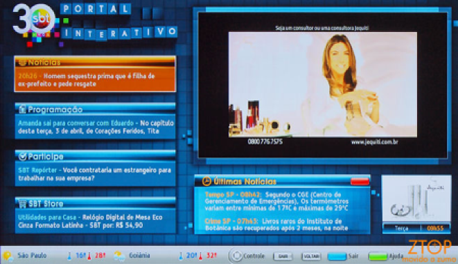
    </div>
    <div style="flex: 1 1 0; min-width: 0; display: flex; justify-content: center; align-items: center; height: 215px;">
      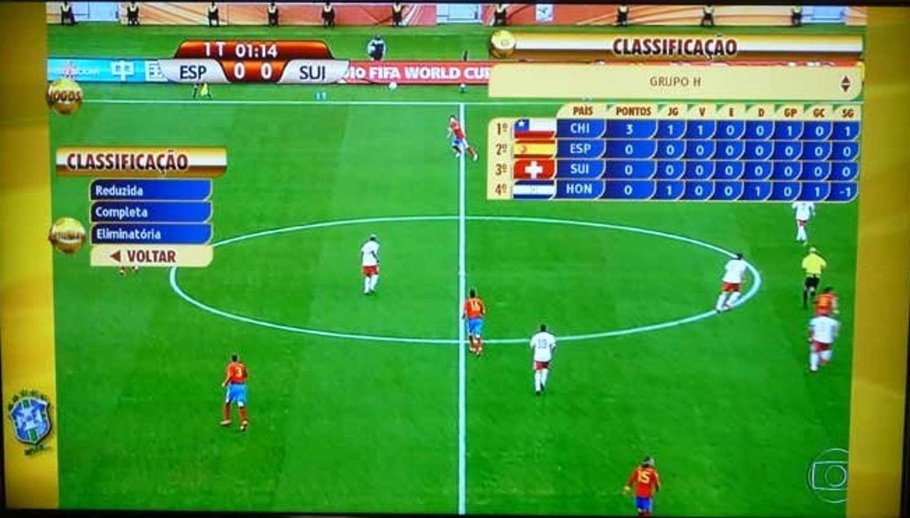
    </div>
  </div>
  <div style="display: flex; justify-content: space-between; gap: 24px; width: 100%;">
    <div style="flex: 1 1 0; min-width: 0; display: flex; justify-content: center; align-items: center; height: 215px;">
      
    </div>
    <div style="flex: 1 1 0; min-width: 0; display: flex; justify-content: center; align-items: center; height: 215px;">
      
    </div>
  </div>
</div>

---

# Context: Ginga is academic let effort

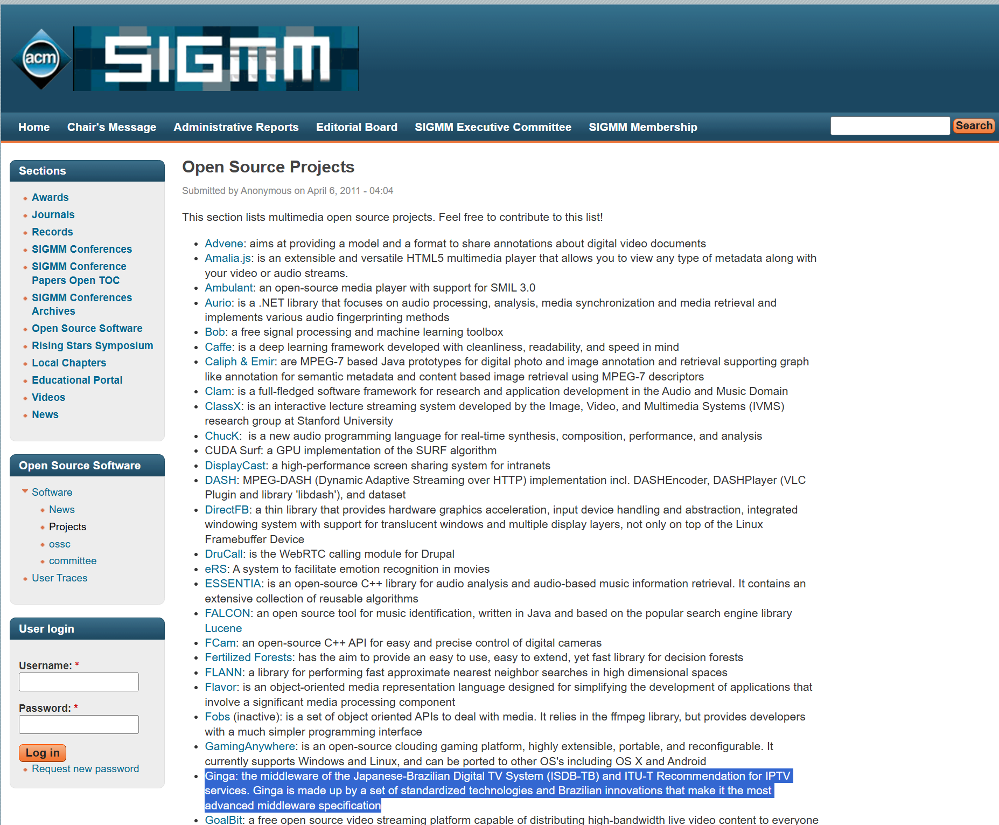

---

<!-- _class: 2-columns-3fr1fr -->

# Context: Ginga plays NCL documents

## Example video.ncl

- ```xml
  <media id="video"  src="butterfly.mp4">
      <area id="a1" begin="2s" end="4s"/>
  </media>
  <media id="green_bg">
      <property name="background" value="green"/>
      <property name="bounds" value="0%,80%,20%,20%"/>
  </media>
  <media id="red_bg">
      <property name="background" value="red"/>
      <property name="bounds" value="80%,80%,20%,20%"/>
      <property name="explicitDur" value="2s"/>
  </media>
  ...
  ```

- 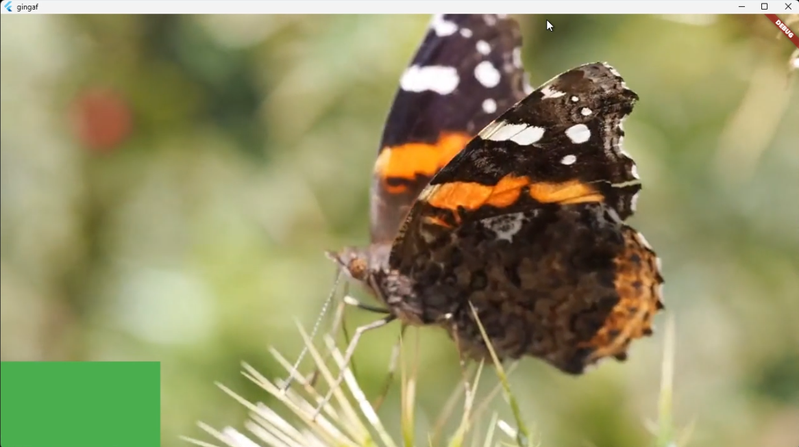

  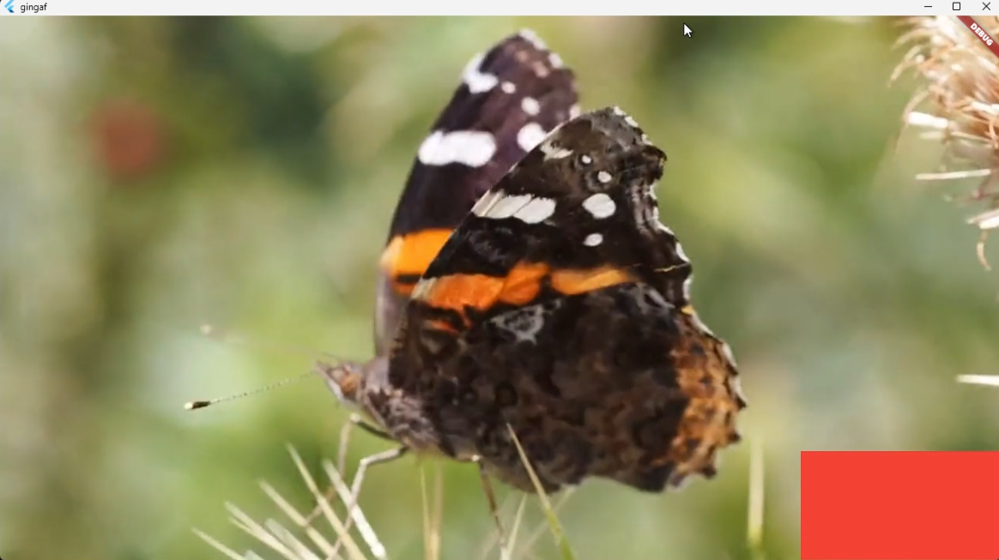

---

<!-- _class: 2-columns-3fr1fr -->

# Context: Ginga is academic let effort

## Example video.ncl

- ```xml
  ...
  <port id="init" component="video"/>
  <link id="l1">
      <bind role="onBegin" component="video" interface="a1"/>
      <bind role="start" component="green_bg"/>
  </link>
  <link id="l2">
      <bind role="onEnd" component="video" interface="a1"/>
      <bind role="stop" component="green_bg"/>
      <bind role="start" component="red_bg"/>
  </link>
  ```

- 

  

---

# Context: Other TV systems also have XML-based languages

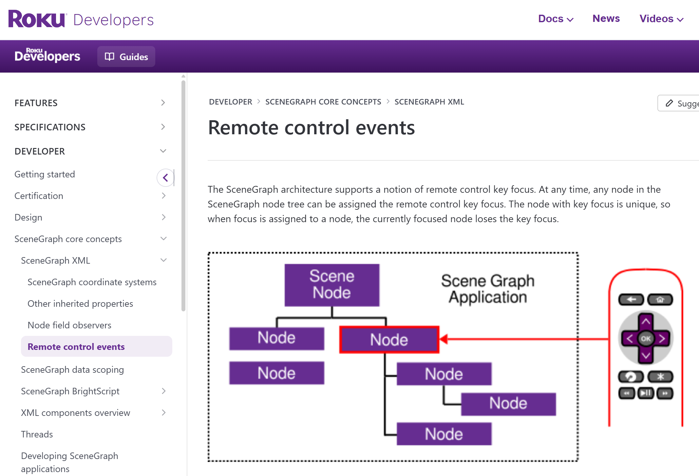

---

# Problem definition: Complexity

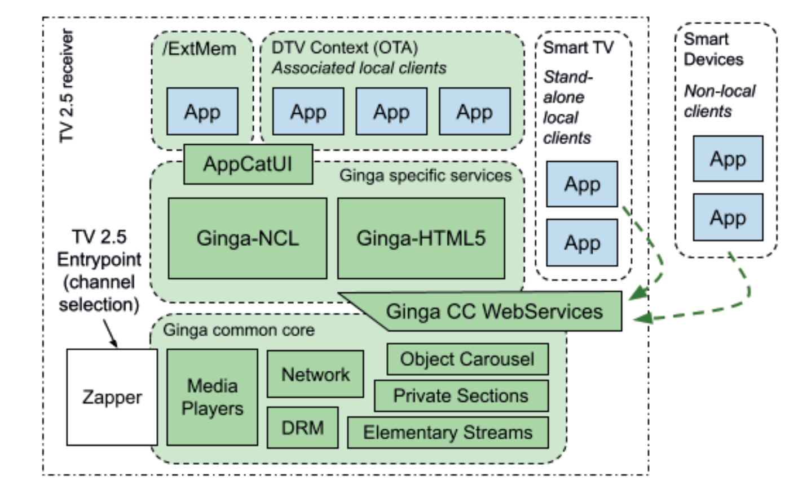

---

# Problem definition: no "zero-install"

- Compare Mozilla (https://developer.mozilla.org/) with Ginga-VM (2010)

<div style="display: flex; justify-content: center; gap: 24px; align-items: center; margin-top: 12px;">
  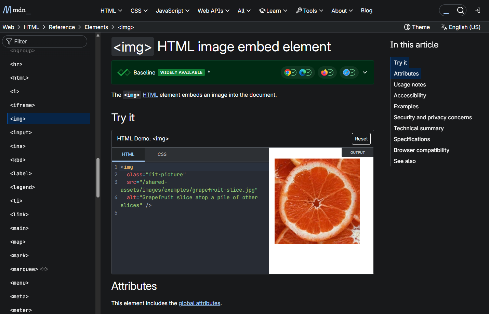
  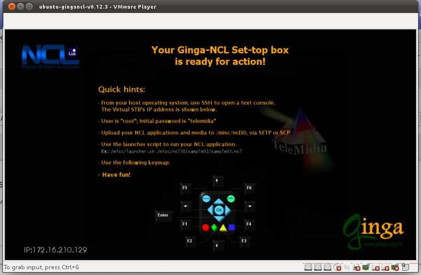
</div>

---

<!-- _class: invert -->
<!-- _paginate: skip -->

# Proposed Solutution

---

# Proposed Solution: portable multimedia engine

<div style="display: grid; grid-template-columns: repeat(3, 1fr); gap: 24px; height: 115px; margin-top: 6px; align-items: center;">
  <div style="font-size: 20px; line-height: 1.6;">

**PUC-Rio (Java AWT)**
**PUC-Rio (C++ & FFmpeg)**
**PUC-Rio (C++ & GStreamer)**

  </div>
  <div style="display: flex; flex-direction: column; align-items: center; justify-content: center; text-align: center;">
    <div style="font-size: 30px; font-weight: 800; color: #0969da; margin-bottom: 6px;">gingaf (ours)</div>
    <div style="font-size: 18px; font-weight: 700; color: #0969da;">
      Ginga-NCL + Ginga-HTML5
    </div>
  </div>
  <div style="font-size: 20px; line-height: 1.6;">

**PUC-Rio (Netscape)**
**UFSCar (WebNCL)**
**Sidia NuGinga (NodeJS)**

  </div>
</div>

<div style="background: #e2e7ee; border: 2px solid #b8c4d1; border-radius: 8px; padding: 4px 0; height: 40px; margin: 8px 0 10px 0; box-shadow: 0 2px 6px rgba(0,0,0,0.05); display: flex; align-items: center; justify-content: center; gap: 32px; box-sizing: border-box;">
  <div style="display: flex; align-items: center; gap: 8px;">
    
    <span style="font-size: 20px; font-weight: 800; color: #1f2328; line-height: 1;">Dart</span>
  </div>
  <div style="display: flex; align-items: center; gap: 8px;">
    
    <span style="font-size: 20px; font-weight: 800; color: #1f2328; line-height: 1;">Flutter</span>
  </div>
</div>

<div style="display: grid; grid-template-columns: repeat(2, 1fr); gap: 32px; height: 145px; margin-top: 6px;">
  <div style="display: flex; flex-direction: column; align-items: center; justify-content: center; text-align: center;">
    <div style="font-size: 24px; font-weight: 700; color: #1f2328; margin-bottom: 6px;">Native</div>
    <div style="display: flex; align-items: center; justify-content: center; gap: 16px; height: 100px;">
      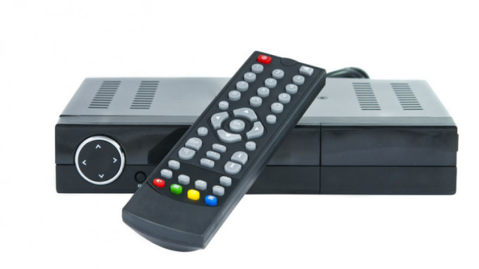
      
    </div>
  </div>
  <div style="display: flex; flex-direction: column; align-items: center; justify-content: center; text-align: center;">
    <div style="font-size: 24px; font-weight: 700; color: #1f2328; margin-bottom: 6px;">Browser</div>
    
  </div>
</div>

---

# Proposed Solution: portable multimedia engine

<div style="display: flex; gap: 16px; justify-content: center; align-items: flex-end; margin-top: 15px;">
  <div style="text-align: center;">
    
    <p style="font-size: 14px; margin-top: 6px; color: #555;">(a) Windows</p>
  </div>
  <div style="text-align: center;">
    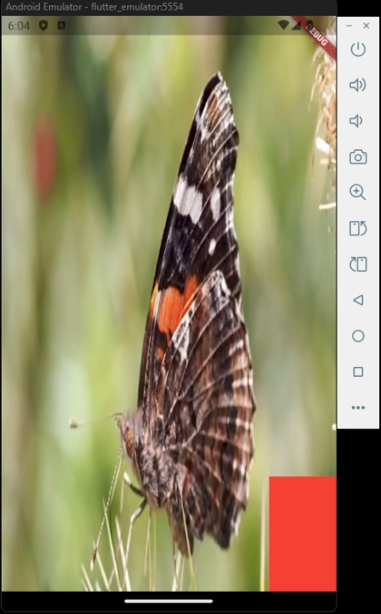
    <p style="font-size: 14px; margin-top: 6px; color: #555;">(b) Android</p>
  </div>
  <div style="text-align: center;">
    
    <p style="font-size: 14px; margin-top: 6px; color: #555;">(c) Web Browser</p>
  </div>
</div>

---

<!-- _class: 2-columns -->

# Proposed Solution: Architecture

- **Legacy Ginga Architecture**

  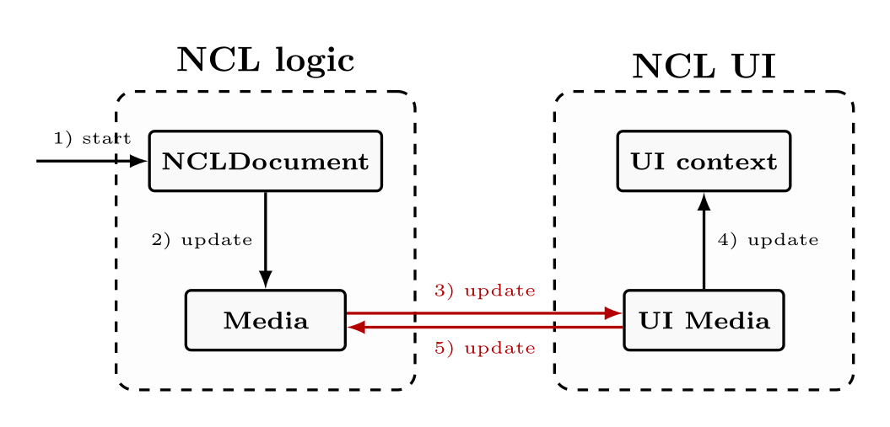

  <span style="font-weight: 700; color: #f85149;">No virtual clock & coupled UI-logic</span>

- **Gingaf Architecture**

  

  <span style="font-weight: 700; color: #3fb950;">Virtual clock & decoupled UI-logic</span>

---

# Proposed Solution: Virtual clock

It allows advancing simulated playback time arbitrarily without waiting for real-world elapsed seconds.


---

<!-- _class: invert -->
<!-- _paginate: skip -->

# Final Remarks

---

<!-- _class: grid-2x2 -->

## Demos: NCL+links, NCL+videos_grid, NCL+embNCL, and NCL+navigation

- 
  NCL with basic links ([video.ncl](https://ginga.org.br/gingaf/playground/?app=video.ncl))

- 
  NCL with videos grid ([video_grid.ncl](https://ginga.org.br/gingaf/playground/?app=video_grid.ncl))

- 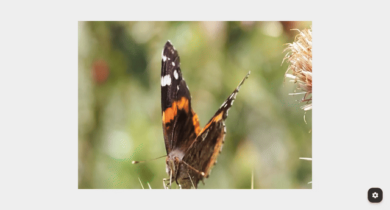
  NCL embedded with NCL ([emb_ncl.ncl](https://ginga.org.br/gingaf/playground/?app=emb_ncl.ncl))

- 
  NCL with focus navigation and selection ([focus_nav.ncl](https://ginga.org.br/gingaf/playground/?app=focus_nav.ncl))

---

<!-- _class: 2-columns -->

# Demos: Playground

- 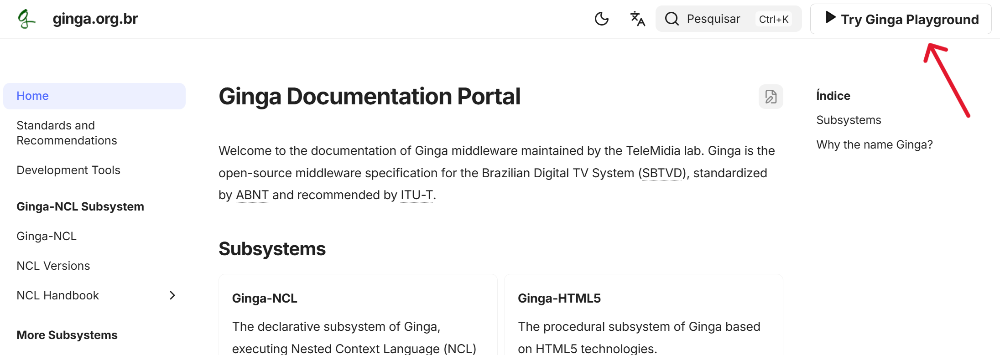

- 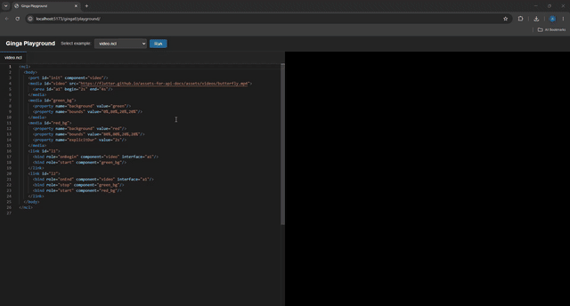

---

<!-- _class: cards-2x2 -->

# Contributions

- **1. Multiplatform Graphics Engine**
  Single Dart/Flutter multiplataform code

- **2. Decoupled UI**
  In-memory NCL state machine isolated from UI rendering

- **3. Virtual Clock**
  time progression via `tick()`

- **4. Open-Source**
  https://github.com/ginga-org-br/gingaf

---

<!--
_paginate: false
_class: 2-columns-1fr3fr
-->

# Thank You!

- **Find more about Ginga** at https://ginga.org.br

  **Contact**: `a.guedes@reading.ac.uk`

- 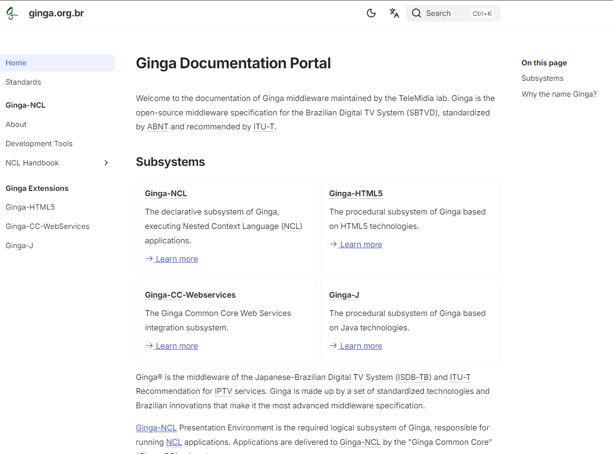
