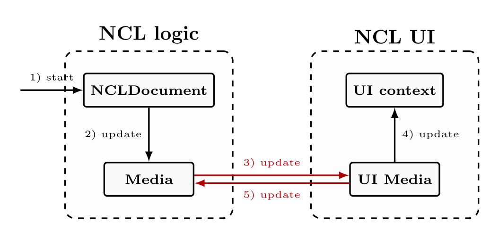
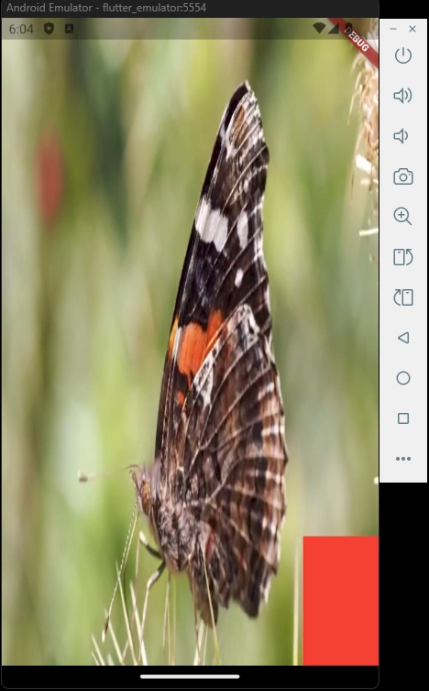
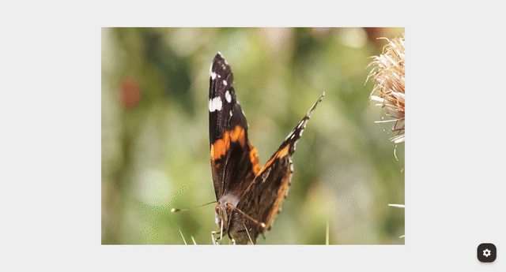
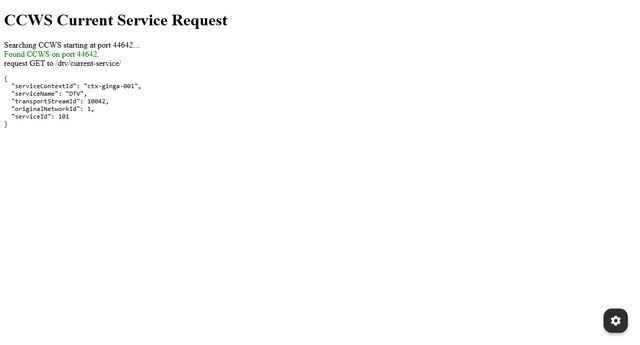

<style>
.grayscale {
  filter: grayscale(100%);
}
.grid-2x2 {
  display: grid;
  grid-template-columns: repeat(2, 1fr);
  grid-gap: 14px 28px;
  width: 100%;
  margin-top: 8px;
}
.grid-card {
  display: flex;
  flex-direction: column;
  align-items: center;
  text-align: center;
}
.grid-card img {
  width: 100%;
  max-height: 165px;
  object-fit: contain;
  border-radius: 6px;
  border: 1px solid transparent;
  background-color: transparent;
  box-shadow: none;
}
.grid-card p {
  margin: 6px 0 0 0;
  font-size: 18px;
  font-weight: 600;
  line-height: 1.3;
  color: #1f2328;
}
.grid-card a {
  color: #0969da;
  font-weight: 700;
  text-decoration: underline;
}
</style>

<!--
_paginate: false
_header: ""
-->

<div style="display: grid; grid-template-columns: 3fr 1fr; align-items: center;">

<div>

# gingaf: Headless and Multiplatform Execution of ITU-SBTVD NCL Applications

**Alan L. V. Guedes**
Computer Science, University of Reading, UK

*ACM International Conference on Multimedia (MM '26)*
Rio de Janeiro, BR

**Paper Website (slides, code, demo)**:
https://alanlivio.github.io/paper-mm26-gingaf/

</div>

<div style="display: flex; flex-direction: column; justify-content: center;">


</div>

</div>

---

# Agenda

- **Context & Problem Definition**
- **Proposed Solution**
- **gingaf Features & Demo**
- **Final Remarks**

---

<!-- _class: invert -->
<!-- _paginate: skip -->

# Context & Problem Definition

---

# Context

**Nested Context Language (NCL)**
- Core standard of ITU-T H.761 and SBTVD ABNT 15606-2.
- Legally mandated on 100% of certified Digital TV receivers in Latin America (>60M viewers).

**Strategic Reach & The Tooling Gap**
- Deployed in national public programs (e.g., Brazil4D) and TV 3.0 standards.
- Despite high reach, developer tooling and accessible testing environments remain severely restricted.
---

# Problems

<div style="display: grid; grid-template-columns: 3fr 2fr">

<div>

**P1: Lack of Accessible Development Environments**
- Legacy Ginga players require dedicated Linux installations and heavy media frameworks (SDL, GStreamer, FFmpeg).
- Web execution was previously impossible due to native desktop library dependencies.

**P2: Lack of Debugging & Inspection Features**
- Tight coupling between presentation UI and document state machine.
- Inability to pause execution, advance time deterministically, or inspect intermediate states in memory.

</div>

<div>

</div>

</div>

---

<!-- _class: invert -->
<!-- _paginate: skip -->

# Proposed Solution

---

# Key Architectural Insight: Decoupling

<div style="display: grid; grid-template-columns: 3fr 2fr">

<div>

**Legacy Architecture Limitations**
- Bidirectional coupling between NCL logic and UI rendering.
- State machines could not execute without active display contexts and native audio/video decoders.

**gingaf Solution**
- Standalone, headless Dart package (`ncl_doc`).
- Isolated UI presentation within Flutter widget layer (`ncl_app`).
- Communication is strictly unidirectional from the UI layer to the headless engine (`tick()`).

</div>

<div>




</div>

</div>

---

# Architectural Overview & NCL DOM

<div style="display: grid; grid-template-columns: 3fr 2fr">

<div>

**Headless NCL Logic (`ncl_doc`)**
- In-memory event state machine managing media nodes, areas, and links.
- Independent of rendering backends, operating systems, and display drivers.

**NCL DOM Hierarchy**
- Element $\rightarrow$ Node $\rightarrow$ Media, Composition, Context, Switch, NCLua.

**Multiplatform Presentation (`ncl_app`)**
- Flutter widget driving visual media, layout, and rendering.
- Single codebase targeting Windows, Linux, macOS, iOS, Android, and Web.

</div>

<div>


</div>

</div>

---

# Headless Execution & Deterministic Testing

**Virtual Clock Mechanism**
- Allows advancing simulated playback time arbitrarily without waiting for real-world elapsed seconds.

**Fast-Forward State Inspection**
- Execute thousands of ticks per second for rapid integration testing and automated regression suites.

**Time-Travel Debugging**
- Step forward and backward through NCL events to pinpoint race conditions or invalid link triggers.

---

# Multiplatform Visual Presentation

**Unified Cross-Platform Engine**
- Single codebase runs natively across desktop (Windows), mobile (Android), and browser (Web).
- Video/audio playback hooked directly to headless state machine.

<div style="display: flex; gap: 16px; justify-content: center; align-items: flex-end; margin-top: 15px;">
  <div style="text-align: center;">
    
    <p style="font-size: 14px; margin-top: 6px; color: #555;">(a) Windows</p>
  </div>
  <div style="text-align: center;">
    
    <p style="font-size: 14px; margin-top: 6px; color: #555;">(b) Android</p>
  </div>
  <div style="text-align: center;">
    
    <p style="font-size: 14px; margin-top: 6px; color: #555;">(c) Web Browser</p>
  </div>
</div>

---

# Example Execution: video.ncl

```xml
<ncl>
  <body>
    <port id="init" component="video"/>
    <media id="video" src="https://flutter.github.io/assets-for-api-docs/assets/videos/butterfly.mp4">
      <area id="a1" begin="2s" end="4s"/>
    </media>
    <media id="green_bg">
      <property name="background" value="green"/>
      <property name="bounds" value="0%,80%,20%,20%"/>
    </media>
    <media id="red_bg">
      <property name="background" value="red"/>
      <property name="bounds" value="80%,80%,20%,20%"/>
      <property name="explicitDur" value="2s"/>
    </media>
    <link id="l1">
      <bind role="onBegin" component="video" interface="a1"/>
      <bind role="start" component="green_bg"/>
    </link>
    <link id="l2">
      <bind role="onEnd" component="video" interface="a1"/>
      <bind role="stop" component="green_bg"/>
      <bind role="start" component="red_bg"/>
    </link>
  </body>
</ncl>
```

---

# Example Execution: video.ncl

<div style="display: grid; grid-template-columns: 3fr 2fr">

<div>

**Temporal Synchronization Scenario**
- Main video plays from `0s` to `7s`.
- Area anchor `a1` spans from `2s` to `4s`.
- Link `l1`: When `a1` begins (`2s`), green background starts.
- Link `l2`: When `a1` ends (`4s`), green stops and red starts for `2s`.

**Deterministic Consistency**
- All targets display identical synchronized state at `t=2s`, `t=4s`, and `t=6s`.

</div>

<div>


</div>

</div>

---

<!-- _class: invert -->
<!-- _paginate: skip -->

# gingaf Features & Demo

---

## NCL+links, NCL+videos_grid, NCL+embNCL, and NCL+navigation

<div class="grid-2x2">
  <div class="grid-card">
    
    <p>NCL with basic links (<a href="https://ginga-org-br.github.io/gingaf/playground/?app=video.ncl">video.ncl</a>)</p>
  </div>
  <div class="grid-card">
    
    <p>NCL with videos grid (<a href="https://ginga-org-br.github.io/gingaf/playground/?app=video_grid.ncl">video_grid.ncl</a>)</p>
  </div>
  <div class="grid-card">
    
    <p>NCL embedded with NCL (<a href="https://ginga-org-br.github.io/gingaf/playground/?app=emb_ncl.ncl">emb_ncl.ncl</a>)</p>
  </div>
  <div class="grid-card">
    
    <p>NCL with focus navigation and selection (<a href="https://ginga-org-br.github.io/gingaf/playground/?app=focus_nav.ncl">focus_nav.ncl</a>)</p>
  </div>
</div>

---

## NCLua, HTML+CCWS, NCL+embHTML, and NCL+multiuser

<div class="grid-2x2">
  <div class="grid-card">
    
    <p>NCL with lua canvas drawing and keys (<a href="https://ginga-org-br.github.io/gingaf/playground/?app=lua_canvas.ncl">lua_canvas.ncl</a>)</p>
  </div>
  <div class="grid-card">
    
    <p>HTML with CCWS /current-service/ (<a href="https://ginga.org.br/gingaf/playground/?app=current_service.html">current_service.html</a>)</p>
  </div>
  <div class="grid-card">
    
    <p>NCL with embedded HTML document (<a href="https://ginga-org-br.github.io/gingaf/playground/?app=emb_html.ncl">emb_html.ncl</a>)</p>
  </div>
  <div class="grid-card">
    
    <p>NCL with multi-user profile switching and targeted advertising (<a href="https://ginga-org-br.github.io/gingaf/playground/?app=multiuser_profile/main.ncl">multiuser_profile/main.ncl</a>)</p>
  </div>
</div>

---

<!-- _class: invert -->
<!-- _paginate: skip -->

# Final Remarks

---

# Final Remarks

- Headless execution engine enabling in-memory unit testing and deterministic debugging.
- Cross-platform presentation across mobile, desktop, and web from a single codebase.
- Reproducible artifacts, interactive demos, and source code available openly.

---

<!--
_paginate: false
_header: ""
-->

# Thank You!

<div style="display: grid; grid-template-columns: 3fr 2fr">

<div>

### Questions & Discussion

- **Repository**: https://github.com/ginga-org-br/gingaf
- **Contact**: `a.guedes@reading.ac.uk`

</div>

<div>


</div>

</div>
