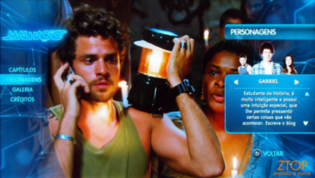
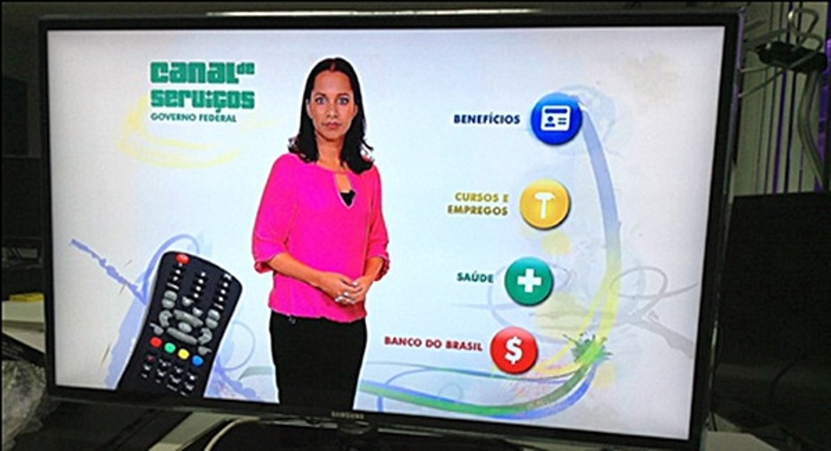
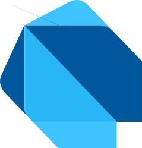
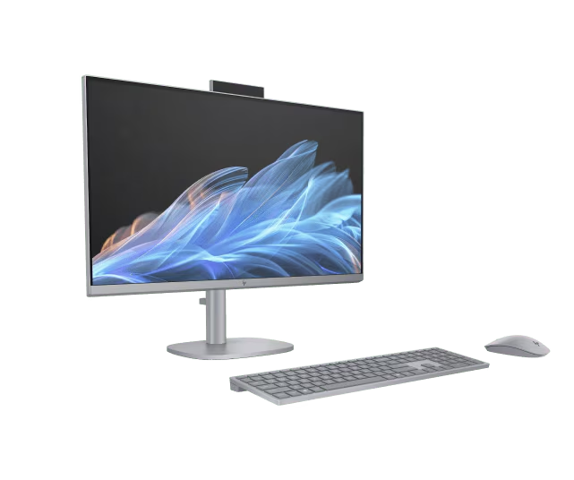
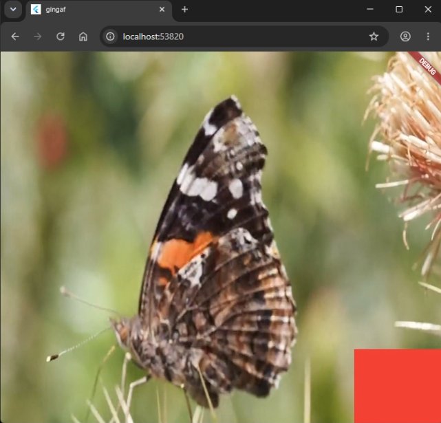
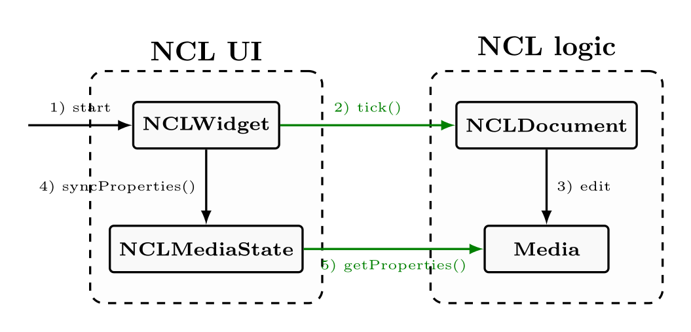
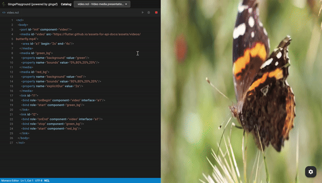
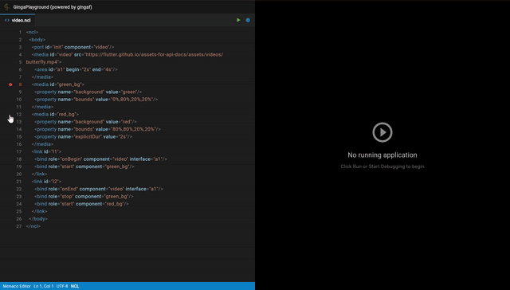

<!--
_paginate: false
_header: ""
_class: cols-3-1 vcenter
-->

- # gingaf: Headless and Multiplatform Execution of ITU-SBTVD NCL Applications

  **Alan L. V. Guedes**
  Computer Science, University of Reading, UK

  *ACM International Conference on Multimedia (MM '26)*
  Rio de Janeiro, BR

  **Paper Website (slides, code, demo)**:
  https://alanlivio.github.io/paper-mm26-gingaf/

- 

  

---

# Agenda

- **Context & Problem Definition**
- **Proposed Solution**
- **gingaf Features & Demo**
- **Final Remarks**

---

<!-- _class: invert -->
<!-- _paginate: skip -->

# Context & Problem Definition

---

<!-- _class: grid-2x2 -->

# Context: Ginga is a TV software (>60M TV set-top boxes in South America)

- 

- 

- 

- 

---

# Context: Ginga is an academic-led effort


---

<!-- _class: cols-3-1 vcenter -->

# Context: Ginga plays NCL documents

## Example video.ncl

- ```xml
  <media id="video"  src="butterfly.mp4">
      <area id="a1" begin="2s" end="4s"/>
  </media>
  <media id="green_bg">
      <property name="background" value="green"/>
      <property name="bounds" value="0%,80%,20%,20%"/>
  </media>
  <media id="red_bg">
      <property name="background" value="red"/>
      <property name="bounds" value="80%,80%,20%,20%"/>
      <property name="explicitDur" value="2s"/>
  </media>
  ...
  ```

- 

  

---

<!-- _class: cols-3-1 vcenter -->

# Context: Ginga plays NCL documents

## Example video.ncl

- ```xml
  ...
  <port id="init" component="video"/>
  <link id="l1">
      <bind role="onBegin" component="video" interface="a1"/>
      <bind role="start" component="green_bg"/>
  </link>
  <link id="l2">
      <bind role="onEnd" component="video" interface="a1"/>
      <bind role="stop" component="green_bg"/>
      <bind role="start" component="red_bg"/>
  </link>
  ```

- 

  

---

# Context: Other TV systems also have XML-based languages


---

# Problem definition: Complexity


---

<!-- _class: cols-2 vcenter -->

# Problem definition: no "zero-install"

Compare Mozilla (https://developer.mozilla.org/) with Ginga-VM (2010)

- 

- 

---

<!-- _class: invert -->
<!-- _paginate: skip -->

# Proposed Solution

---

# Proposed Solution: portable multimedia engine

<div class="cols-3 spread vcenter">

- **PUC-Rio (Java AWT)**
  **PUC-Rio (C++, FFmpeg)**
  **PUC-Rio (C++, GStreamer)**

- <span style="font-size: 30px; font-weight: 800; color: #0969da;">gingaf (ours)</span>
  <span style="font-size: 18px; font-weight: 700; color: #0969da;">Ginga-NCL + Ginga-HTML5</span>

- **PUC-Rio (Netscape)**
  **UFSCar (WebNCL)**
  **Sidia NuGinga (NodeJS)**

</div>

<div class="banner">

 **Dart**  **Flutter**

</div>

<div class="cols-3 spread vcenter">

- **Native**
   

-

- **Browser**
  

</div>

---

<!-- _class: cols-3 center -->

# Proposed Solution: portable multimedia engine

- 
  (a) Windows

- 
  (b) Android

- 
  (c) Web Browser

---

<!-- _class: cols-2 center -->

# Proposed Solution: Architecture

- **Previous ginga Implementations**

  

  <span style="font-weight: 700; color: #f85149;">No virtual clock & coupled UI-logic</span>

- **`gingaf` Architecture**

  

  <span style="font-weight: 700; color: #3fb950;">Virtual clock & decoupled UI-logic</span>

---

# Proposed Solution: Virtual clock

It allows advancing simulated playback time arbitrarily without waiting for real-world elapsed seconds.


---

<!-- _class: invert -->
<!-- _paginate: skip -->

# Final Remarks

---

<!-- _class: cols-2 -->

# Demos: Playground

- 

- 

---

# Demos: Playground Debug



---

<!-- _class: grid-2x2 -->

# Contributions

- **1. Multiplatform Graphics Engine**
  Single Dart/Flutter multiplatform code

- **2. Decoupled UI**
  In-memory NCL state machine isolated from UI rendering

- **3. Virtual Clock**
  Time progression via `tick()` and allow debug

- **4. Open-Source**
  https://github.com/ginga-org-br/gingaf

---

<!--
_paginate: false
_class: cols-1-3
-->

# Thank You!

- **Find more about Ginga** at https://ginga.org.br

  **Contact**: `a.guedes@reading.ac.uk`

- 
